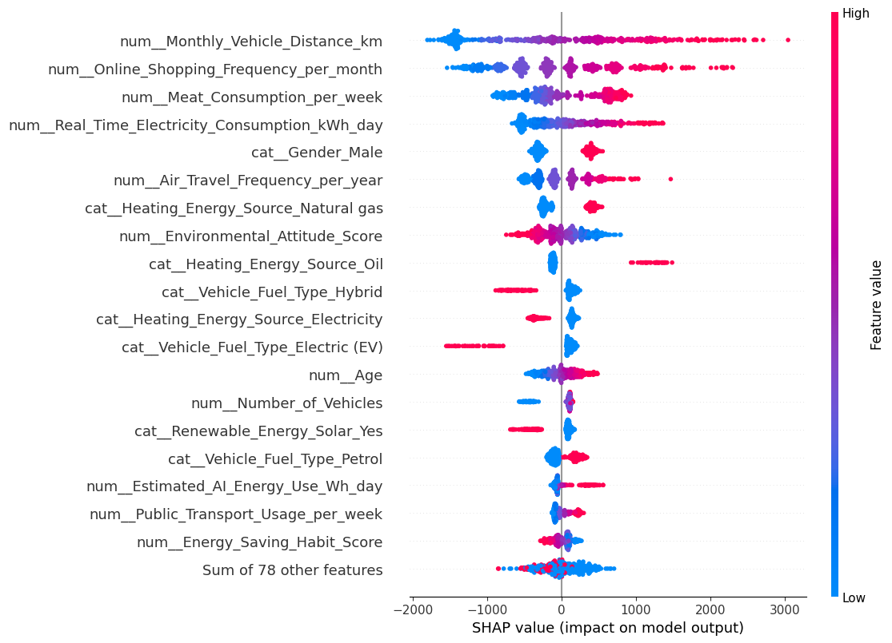
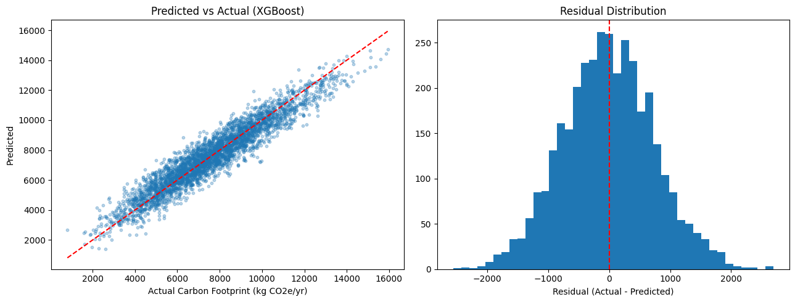

# Explainable ML for individual carbon-footprint prediction

Code for the paper **"Explainable ML for Individual Carbon-Footprint Prediction from Traditional, Digital, and AI Behaviors"**, accepted for oral presentation at AAI 2026, the International Conference on Advances in Artificial Intelligence (UniMAP, Langkawi, Malaysia, 21 to 23 December 2026).

Authors: Md. Siyam Hossain (first author), Nadim Mahmud (second author) and co-authors. The work started as an AI Lab course project at Daffodil International University.

## The question

Most carbon-footprint models look at housing, transport and diet. This project adds digital habits (streaming, devices, cloud storage) and AI use, and asks which behaviours drive one person's yearly footprint, so the advice can be specific to that person.

## What the notebook does

1. Loads the dataset: 18,000 synthetic respondents, 49 features and a target of kg CO2e per year.
2. Splits 80/20 into train and test before any cleaning. Imputation, IQR outlier clipping and one-hot encoding are fit on the training data only, inside scikit-learn pipelines, and missing-value flags are added for the four columns that have gaps.
3. Trains Random Forest, XGBoost and an MLP with the same preprocessing, then runs 5-fold cross-validation for all three and a randomized hyperparameter search for the two tree models.
4. Explains the tree models with SHAP (TreeExplainer on 500 test rows) and the MLP with permutation importance.
5. Checks residuals and saves the best pipeline with joblib.

## Results (test set, 3,600 rows)

| Model | R² | MAE (kg CO2e) | RMSE (kg CO2e) |
|---|---|---|---|
| XGBoost (tuned) | **0.897** | **596** | **747** |
| MLP | 0.884 | 638 | 793 |
| Random Forest (tuned) | 0.784 | 860 | 1083 |

5-fold cross-validation R² before tuning: XGBoost 0.888 ± 0.002, MLP 0.880 ± 0.004, Random Forest 0.701 ± 0.004.

The features that move predictions most, by mean absolute SHAP value for XGBoost: monthly vehicle distance, online shopping frequency, meat meals per week, daily electricity use and air travel per year. All three models agree on vehicle distance and online shopping as the top two.

## Data

`data/carbon_footprint_dataset.csv` is a synthetic dataset our team generated for this study. It has 18,000 rows and 50 columns covering demographics, home energy, transport, diet, shopping, digital habits and AI use, with about 1.5 to 3% missing values added to four columns to look like real survey data. Some columns use the category "None" (for example no heating or no AC), so the notebook reads the file with `keep_default_na=False` to keep those as real values.

## Running it

The notebook was run on Google Colab.

1. Install the packages in `requirements.txt`.
2. Change the path in the first data cell to `data/carbon_footprint_dataset.csv`.
3. Run all cells. The best model is saved as `best_model_XGBoost.pkl`.

## License

MIT (see `LICENSE`).
